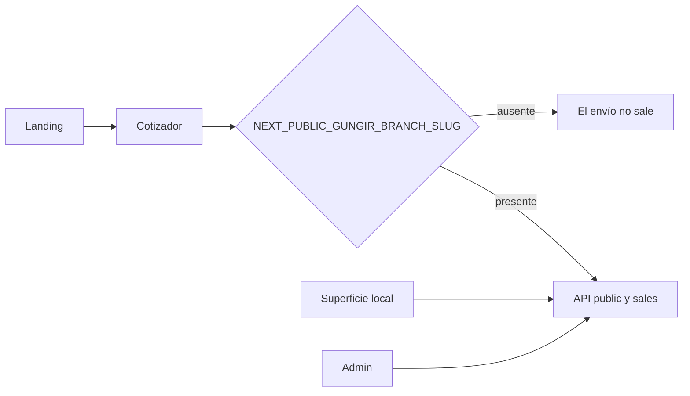

# Arquitectura — Gungir

Next.js (App Router) con tres superficies útiles y una cuarta marcada como pendiente.

## Estructura

```
src/app           /, cuenta, local, admin, login, super
src/components    landing, cotizador, chrome, auth
src/lib/api       llamadas a la API
src/content       textos de la landing
```

## Flujo del cotizador



El grupo (`NEXT_PUBLIC_GUNGIR_GROUP`) elige el conjunto comercial. El slug elige la sucursal del cotizador. La API impone la sucursal en el servidor. El cliente no manda otra sucursal en el body para saltarse ese aislamiento.

## Contrato

No hay generación de tipos. Un cambio de quotes o de accounts se ve al probar el formulario y al leer `docs/CONSUMERS.yaml` cuando el backend publica un reporte de impacto.
